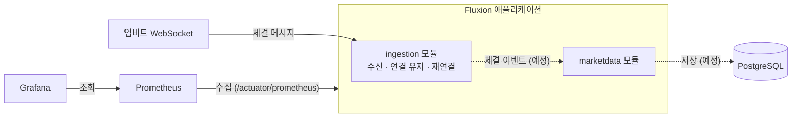

# Fluxion

거래소에서 발생하는 실시간 체결 데이터를 수집·처리하는 백엔드 플랫폼입니다.

> 상태: 초기 개발 단계입니다. 현재 업비트 WebSocket 체결 수신까지 구현되어 있습니다.

## 프로젝트 목표

거래소 체결 데이터는 체결이 일어날 때마다 WebSocket으로 스트리밍됩니다. 네트워크 장애나 서버 문제로 연결이 예기치 않게 종료될 수 있으며, 연결이 중단된 동안 발생한 체결 데이터는 WebSocket을 통해 자동으로 복구되지 않습니다.

Fluxion은 연결 장애와 데이터 누락을 감지하고 복구하는 수집 파이프라인을 만드는 것을 1차 목표로 합니다. 이후 수집한 데이터를 바탕으로 분석과 모의 거래 기능으로 확장할 계획입니다.

## 설계 방향

- 모듈형 모놀리스 구조로 시작하며, Spring Modulith를 활용해 모듈 간 의존 관계와 경계를 검증합니다. 향후 거래소나 증권사 등 수집 대상이 확대되더라도, 각 API의 차이가 다른 모듈에 영향을 주지 않도록 설계합니다. 모듈 간 데이터 전달에는 이벤트 기반 통신을 적용할 계획입니다. ([#21](https://github.com/LiamKim-DaeYong/fluxion/issues/21))
- Kafka, Redis 등의 인프라는 성능 측정 결과와 실제 운영 요구사항을 바탕으로 도입 여부를 결정합니다.
- 성능 및 장애 대응 결과는 실험 조건과 측정 결과를 함께 기록하여 검증 가능한 근거를 남깁니다.

## 아키텍처



실선은 구현된 흐름, 점선은 예정된 흐름입니다.

## 구현 현황

| 기능 | 상태 | 내용 | 관련 |
|---|---|---|---|
| 모듈 구조 | 완료 | `ingestion`(수집), `marketdata`(시장 데이터) 경계와 의존 방향을 테스트로 검증 | [#21](https://github.com/LiamKim-DaeYong/fluxion/issues/21) |
| 이벤트 발행 레지스트리 | 완료 | Spring Modulith가 모듈 간 이벤트 전달 기록을 남기는 `event_publication` 테이블을 Flyway로 관리, Testcontainers 통합 테스트 | [#19](https://github.com/LiamKim-DaeYong/fluxion/issues/19) |
| 업비트 체결 수신 | 완료 | 체결 구독, ping으로 연결 유지(30초), 지수 백오프 재연결(1초~30초), 응답 없는 연결 감지. 로컬 WebSocket 테스트 서버로 자동화 테스트 | [#23](https://github.com/LiamKim-DaeYong/fluxion/issues/23), [#28](https://github.com/LiamKim-DaeYong/fluxion/pull/28) |
| 관측성 | 완료 | Actuator 메트릭, Prometheus 수집, Grafana 대시보드 | [#6](https://github.com/LiamKim-DaeYong/fluxion/issues/6), [#8](https://github.com/LiamKim-DaeYong/fluxion/issues/8) |
| 수신 메트릭과 처리량 측정 | 완료 | 수신 메시지 수 Counter, 초당 체결 수 측정 | [#23](https://github.com/LiamKim-DaeYong/fluxion/issues/23) |
| 구독 실패 감지 | 예정 | 구독 요청이 거부되었으나 WebSocket 연결은 유지되는 상황을 감지 | [#31](https://github.com/LiamKim-DaeYong/fluxion/issues/31) |
| 종료 시 연결 정리 | 예정 | 애플리케이션 종료 시 진행 중인 연결 시도를 안전하게 정리 | [#30](https://github.com/LiamKim-DaeYong/fluxion/issues/30) |
| 체결 이벤트 발행과 저장 | 예정 | `ingestion` → `marketdata` 이벤트, PostgreSQL 저장 | |
| 연결 중단 구간 데이터 복구 | 예정 | 연결 중단 구간의 체결 데이터를 REST API에서 조회 가능한 범위 내에서 보완 | |

## 기술 과제

해결 중이거나 앞으로 다룰 문제입니다. 결과가 검증되면 핵심 사례로 정리합니다.

- 연결 장애와 재연결: 서버 종료, 네트워크 단절, 응답 없는 연결을 감지해 다시 연결합니다. 로컬 테스트 서버로 시나리오별 자동화 테스트를 작성했습니다.
- 데이터 누락 감지와 복구: 연결이 끊긴 구간의 체결을 REST API로 보충합니다.
- 중복 처리와 정합성: WebSocket과 REST로 같은 체결이 두 번 들어올 수 있습니다. 업비트 체결 ID(`sequential_id`)는 유일하지만 순서를 보장하지 않습니다.
- 수집 처리량과 저장 처리량의 차이: 실제 체결 데이터의 유입량을 측정하고, 이를 바탕으로 적절한 저장 전략을 결정합니다.

## 기술 스택

| 분류 | 사용 |
|---|---|
| 언어·런타임 | Kotlin 2.3.21, Java 25 |
| 프레임워크 | Spring Boot 4.1.1, Spring Modulith 2.1.1 |
| 데이터 | PostgreSQL 18, JPA/Hibernate, Flyway |
| 관측성 | Micrometer, Actuator, Prometheus, Grafana |
| 테스트 | JUnit 5, AssertJ, Testcontainers |
| 빌드·실행 | Gradle Kotlin DSL, Docker Compose, ktlint |

## 실행 방법

필요: JDK 25, Docker

```sh
cp .env.example .env
./gradlew bootRun
```

`bootRun`을 실행하면 Spring Boot Docker Compose 지원이 `compose.yaml`의 PostgreSQL, Prometheus, Grafana를 함께 띄웁니다.

| 주소 | 용도 |
|---|---|
| http://localhost:8080/actuator/prometheus | 애플리케이션 메트릭 |
| http://localhost:9090 | Prometheus |
| http://localhost:3000 | Grafana (계정은 `.env`) |

## 개발 방식

이슈에서 문제와 설계를 논의하고, 브랜치와 PR로 반영합니다. 설계 근거, 대안 비교, 실험 기록은 각 이슈의 본문과 코멘트에 남깁니다. 자세한 규칙은 [CONTRIBUTING.md](CONTRIBUTING.md)를 참고하세요.
